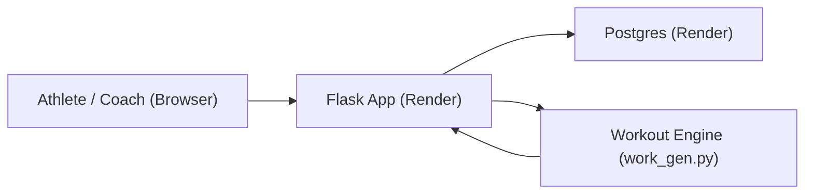

# Workout Generator (Baseball Performance)

A rule-based baseball performance workout generator that turns athlete data into structured, periodized training plans. Built for coaches and athletes who need sport-specific programming, not generic templates.

## Live Demo
- App: https://workout-generator-xtpb.onrender.com
- Demo video: https://www.loom.com/share/d662ef81fb3d42c685bfd3b51d195daf

## What It Does
- Generates sport-specific workouts using NSCA-style movement patterns
- Rotates exercises with block logic and load caps
- Supports phase-based logic (off-season vs in-season)
- Allows admin to edit the exercise library with no code
- Logs workouts and performance metrics

## Features
- Athlete profiles (goals, phase, injuries, metrics)
- Workout generation + logging
- Admin dashboard
- Exercise editor (persisted in Postgres)
- Benchmark QA + performance ratios

## Tech Stack
- Backend: Python, Flask
- Database: Postgres
- Deployment: Render
- Server: Gunicorn
- Frontend: Server-rendered HTML/CSS

## Architecture (High-Level)
Browser -> Flask app -> Postgres

Exercise library and coaching logic live in the database and drive the generator.



## How It Works (Short Version)
1. Athlete profile inputs are stored in Postgres.
2. The generator in `work_gen.py` builds a workout using rules (phase, split, rotation, load caps).
3. Workouts are saved to the database and can be logged after completion.
4. Admin can edit exercises directly from the UI.

## Run Locally
```bash
python3 -m venv .venv
source .venv/bin/activate
pip install -r requirements.txt
export WG_SECRET_KEY="dev"
export WG_ADMIN_CODE="coach-admin-123"
python3 app.py
```

## Admin Access
Use the admin code during registration to create an admin user:
- Admin code: `coach-admin-123` (or your env var)

## Project Goals
This project demonstrates full-stack delivery, domain-specific logic, and production deployment for sports performance software.
