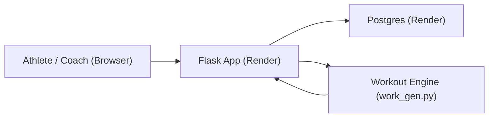

# Workout Generator (Baseball Performance)

A full-stack web app that automates the generation of personalized, periodized training plans for baseball players and uses data to address real training needs.  Built by a former pro baseball player and personal trainer to address the issues with generalized, training programs.

## Live Demo
- Live App: https://workout-generator-xtpb.onrender.com
- Demo Video: https://www.loom.com/share/d662ef81fb3d42c685bfd3b51d195daf

## What It Does
Problem:
Generic workout templates don't address the varying needs of individual athletes during the specific phases of their season and career and can't adapt to injuries or performance in real time.  Manual program design is time-consuming and hard to scale.

Solution:
This application transforms training expertise and individual athlete data into rule-based logic for accurate, repeatable program generation.  It allows the athletes to input, address, and discover their personal training needs.  It enables coaches to monitor athlete progress and manage the exercise library without touching code.

## Features
- Athlete profiles: Collects goals, training phase, injuries, and training availability
- Intelligent, Individualized Workout Generation: Uses rule-based logic to create workout plans using NSCA movement patterns, exercise rotation blocks, and load management
- Admin dashboard: Allows coaches and trainers to view all client data and manage the exercise library with no code
- Data-based Training Insights: Compares your training metrics to other users to give insight into training needs
- Injury Accommodation:  Programs around common injuries

## Tech Stack
- Backend: Python, Flask
- Database: Postgres
- Deployment: Render
- Server: Gunicorn
- Frontend: Server-rendered HTML/CSS

## Architecture (High-Level)
Browser -> Flask app -> Postgres

Exercise library and coaching logic live in the database and drive the generator.



## How It Works (Short Version)
1. Athlete profile inputs are stored in Postgres.
2. The generator in `work_gen.py` builds a workout using rules (phase, goals, split, exercise rotation, load management).
3. Workouts are saved to the database and can be logged by the user.
4. Admin can edit/delete/add exercises directly from the UI.

## Run Locally
```bash
python3 -m venv .venv
source .venv/bin/activate
pip install -r requirements.txt
export WG_SECRET_KEY="dev"
export WG_ADMIN_CODE="coach-admin-123"
python3 app.py
```

## Admin Access
Use the admin code during registration to create an admin user:
- Admin code: `coach-admin-123` 

## Project Goals
This project demonstrates full-stack delivery, domain knowledge, and production deployment for sports performance software.

## About the Developer
Dan Pellinen is a former professional baseball player with a passion for fitness, athletic performance, and tech.  After being drafted by Cleveland in the 2013 MLB Draft, he played college baseball and earned his B.S. in Exercise Science.  He then played Independent Professional Baseball and became a Certified Personal Trainer, expanding his knowledge of performance development while directly applying this info to his clients.  

He became a 200hr Yoga Teacher and incorporated yogic philosophies into his training methodology, eventually publishing "The Yoga Baseball Method".  After layoffs in the fitness industry he turned to tech, earning his A.S. in Software & Web Development.  He now combines his expertise in fitness, sports performance, and software development with his passion for problem-solving to address real problems in fitness and athletic performance.